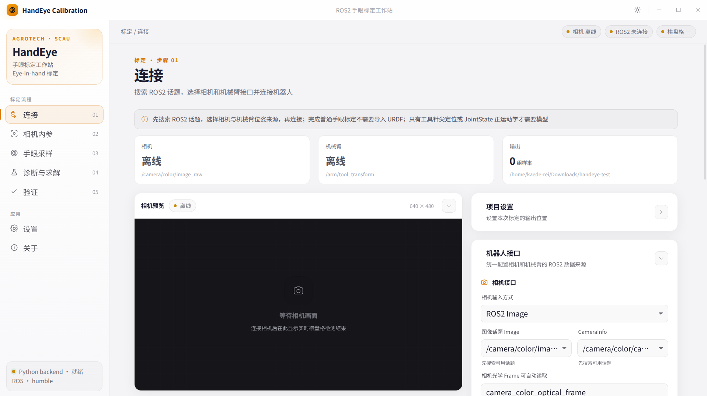
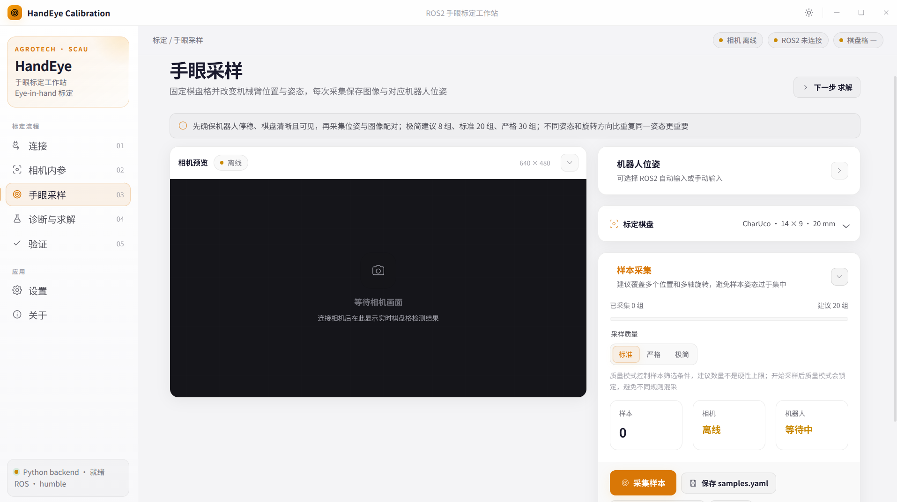
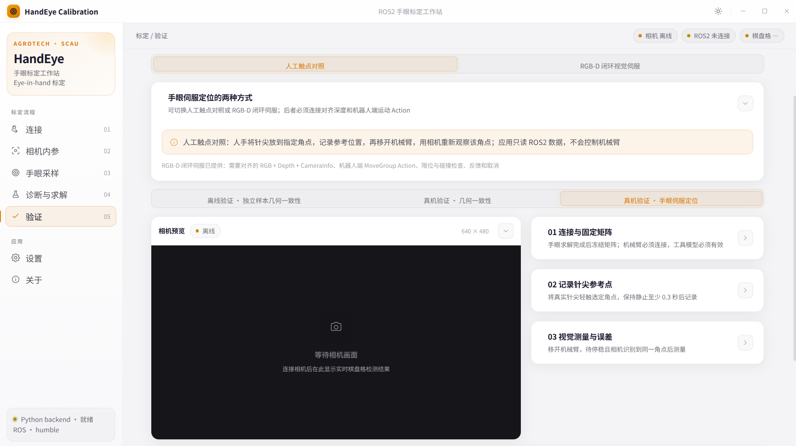
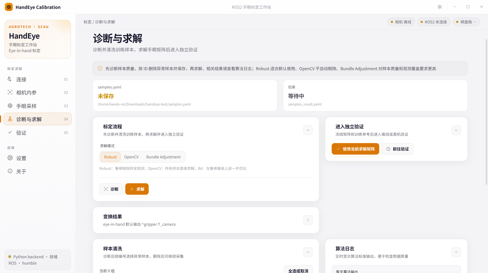
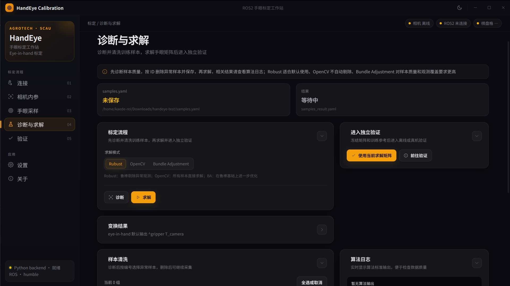

<div align="center">

# Handeye Calibration

**面向机器人研发与工程应用的可视化手眼标定工作台**

独立接入相机与机器人数据，完成采集、求解、诊断与精度验证

<p>
  <a href="https://github.com/AgroTech-SCAU/Handeye-Calibration-App/actions/workflows/build-linux.yml"></a>
  
  
  
  
</p>

[快速开始](#快速开始) · [功能与界面](#功能与界面) · [工作流程](#工作流程) · [使用指南](USER_GUIDE.md) · [问题反馈](https://github.com/AgroTech-SCAU/Handeye-Calibration-App/issues)

</div>

---

## 项目简介

Handeye Calibration 将相机内参、机器人末端位姿、手眼标定与独立几何验证整合到图形化流程中，适用于眼在手上的机械臂标定工作

相机和机器人接口互相解耦，支持采样进度保存与恢复，也支持仅完成采集后切换至其他项目

<p align="center">
  
</p>
<p align="center"><sub>连接工作台 · 按项目管理相机与机械臂数据源</sub></p>

## 功能与界面

### 连接、采样与验证

<table>
  <tr>
    <td width="33%" align="center"><strong>数据连接</strong></td>
    <td width="33%" align="center"><strong>手眼采样</strong></td>
    <td width="33%" align="center"><strong>独立验证</strong></td>
  </tr>
  <tr>
    <td></td>
    <td></td>
    <td></td>
  </tr>
  <tr>
    <td>ROS2 / 本地相机与机器人位姿接入</td>
    <td>棋盘参数、位姿同步与样本保存</td>
    <td>离线、真机及针尖空间触点检查</td>
  </tr>
</table>

### 明暗主题

<table>
  <tr>
    <td width="50%" align="center"><strong>浅色界面</strong></td>
    <td width="50%" align="center"><strong>深色界面</strong></td>
  </tr>
  <tr>
    <td></td>
    <td></td>
  </tr>
</table>

### 主要能力

| 模块 | 功能 |
| :--- | :--- |
| 相机接入 | ROS2 Image / CameraInfo、USB / V4L2 |
| 机器人接入 | TransformStamped、PoseStamped、TF2、JointState + URDF |
| 相机内参 | ChArUco / Chessboard 的采集、导入与求解 |
| 手眼标定 | 采样同步、数据质量诊断、多方法求解与异常样本清洗 |
| 结果管理 | 坐标系记录、矩阵冻结、导出与项目恢复 |
| 几何验证 | 离线验证、真机几何验证、针尖空间触点检查 |
| 机器人模型 | Description / URDF 导入、三维模型与工具 Link 查看 |
| 项目管理 | 保存未求解样本、隔离项目数据、确认后强制切换 |

## 系统架构

相机数据与机器人位姿分别接入，同步采集后进行求解与诊断，最后由独立验证流程检查标定结果


## 快速开始

### 环境准备

- Linux 桌面系统
- Python、Node.js 和 npm
- 如需 ROS2 话题接入，准备对应 ROS2 运行环境
- 如需真机验证，准备相机、机器人位姿话题和安全操作条件

### 安装与启动

```bash
chmod +x ./install.sh ./launch.sh
./install.sh
./launch.sh
```

指定 ROS2 环境后启动

```bash
ROS_SETUP=/path/to/ros/setup.bash ./launch.sh
```

仅体验界面时可使用模拟入口

```bash
npm run start:mock
```

生成 Linux 安装包

```bash
./build_linux.sh
```

## 工作流程

1. **连接** — 选择项目目录、相机图像、CameraInfo 与机器人位姿来源
2. **准备内参** — 导入有效内参，或使用 ChArUco / Chessboard 采集并求解
3. **采样** — 固定标定板，改变末端姿态，停稳后逐组采集样本
4. **诊断与求解** — 检查几何一致性，清理异常样本并估计手眼变换
5. **冻结与验证** — 使用独立样本评估几何残差与空间一致性
6. **项目管理** — 保存未完成采样，在确认后切换项目并继续工作

> **真机使用提醒**
>
> 相机须与选定的机器人末端 Frame 刚性固定，标定板在采样期间相对机器人基座保持静止
>
> 针尖验证仅执行测量，机器人运动由外部系统负责，详细流程见 [使用指南](USER_GUIDE.md)

## 文档与协作

| 入口 | 内容 |
| :--- | :--- |
| [使用指南](USER_GUIDE.md) | 连接、内参、采样、手眼求解与验证步骤 |
| [功能规划](docs/plan.md) | 工程设计原则与维护方向 |
| [贡献说明](.github/CONTRIBUTING.md) | 协作与提交要求 |
| [问题反馈](https://github.com/AgroTech-SCAU/Handeye-Calibration-App/issues) | Bug 反馈与功能建议 |

---

<div align="center">

**AgroTech Innovation Lab**

Robotics · Perception · Calibration

</div>
