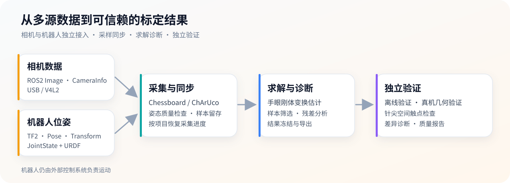

<h1 align="center">Handeye Calibration</h1>

<p align="center"><strong>面向机器人研发与工程应用的可视化手眼标定工具</strong></p>

<p align="center">采集 · 求解 · 诊断 · 验证 · 项目管理</p>

<p align="center">
  <a href="https://github.com/AgroTech-SCAU/Handeye-Calibration-App/actions/workflows/build-linux.yml"></a>
  
  
  
  
</p>

<p align="center"><a href="#快速开始">快速开始</a> · <a href="#核心能力">核心能力</a> · <a href="#标定流程">标定流程</a> · <a href="USER_GUIDE.md">使用指南</a></p>

---

## 项目简介

Handeye Calibration 将相机标定、机器人位姿接入、手眼求解与独立验证整合到桌面 GUI 中，适合机械臂眼在手上标定及标定结果的工程验收

支持 ROS2 与本地相机输入，机器人接口和标定算法相互解耦，可独立完成数据采集，也可恢复已有项目继续求解和验证



## 核心能力

| 模块 | 能力 |
| :--- | :--- |
| 相机接入 | ROS2 Image / CameraInfo、USB / V4L2 图像输入 |
| 机器人接入 | TransformStamped、PoseStamped、TF2、JointState + URDF |
| 相机内参 | Chessboard 与 ChArUco，支持采集、导入与求解 |
| 手眼标定 | 姿态同步、样本质量检查、多方法求解与异常样本清洗 |
| 结果管理 | 矩阵冻结、坐标系记录、文件导出与项目恢复 |
| 独立验证 | 离线样本验证、真机几何验证、针尖空间触点检查 |
| 模型查看 | Description / URDF 导入、坐标系与工具 Link 可视化 |
| 项目切换 | 未完成求解也可保存采样，确认后强制切换独立项目 |

## 眼在手上标定

相机与机械臂末端刚性连接，标定板在采样期间相对机器人基座保持静止，软件根据不同机械臂姿态下的标定板观测求解末端到相机光学坐标系的变换

手眼求解输出末端 Frame 到相机光学 Frame 的刚体变换，平移采用米作为单位，不会自动修改机器人 URDF 或发布 TF

## 快速开始

### 环境准备

- Linux 桌面系统
- Python、Node.js 与 npm
- 使用 ROS2 话题时准备对应的 ROS2 运行环境
- 使用真机功能时准备相机驱动、机器人位姿话题及相应安全措施

### 安装与启动

```bash
chmod +x ./install.sh ./launch.sh ./build_linux.sh ./start_ubuntu.sh ./uninstall.sh

./install.sh
./launch.sh
```

需要指定 ROS2 环境时可使用

```bash
ROS_SETUP=/path/to/ros/setup.bash ./launch.sh
```

仅需体验界面时可使用项目提供的模拟运行入口

```bash
npm run start:mock
```

在已经安装桌面依赖的前提下，使用以下命令生成 Linux 安装包

```bash
./build_linux.sh
```

## 标定流程

1. **连接数据源** — 创建项目，选择相机图像、CameraInfo 与机器人位姿来源
2. **准备相机内参** — 导入已有参数，或通过 Chessboard / ChArUco 完成采集与求解
3. **采集手眼样本** — 固定标定板，改变机械臂末端姿态，稳定后逐组采集
4. **诊断与求解** — 清洗异常样本，检查数据质量并求解手眼矩阵
5. **冻结与验证** — 使用独立样本完成离线或真机几何验证
6. **空间触点检查** — 在具备工具 Link 与安全条件时执行针尖定位精度检查

> [!IMPORTANT]
> 采集过程中应保持相机与末端刚性连接、标定板与机器人基座相对固定，确保机器人坐标系、相机内参及图像分辨率一致

### 项目数据管理

项目数据按输出目录独立存储，采集但尚未求解的样本可以保存并在之后恢复

切换项目时提供主动确认的强制切换操作，避免旧项目数据混入新项目，针尖验证会分别检查实时图像尺寸、相机矩阵与畸变参数是否匹配冻结结果

## 文档与协作

- [使用指南](USER_GUIDE.md) — 数据源配置、采样、手眼求解、验证与工具 Link 使用
- [功能规划](docs/plan.md) — 工程原则与后续维护方向
- [问题反馈](https://github.com/AgroTech-SCAU/Handeye-Calibration-App/issues) — 反馈可复现的问题或提出改进建议
- [贡献说明](.github/CONTRIBUTING.md) — 代码贡献与协作要求

---

<p align="center"><strong>AgroTech-SCAU · Robotics & Calibration</strong></p>
